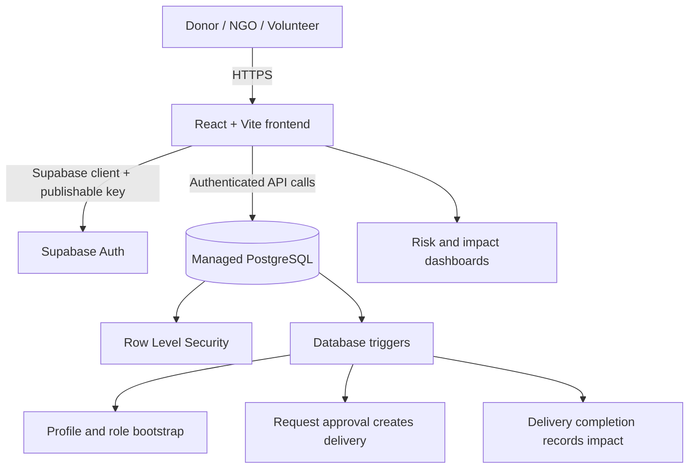

# RePlate — FT-III Case Study Report and Viva Notes

## 1. Title
**RePlate: Cloud-Based Food Waste Risk Prediction and Redistribution System**

## 2. Problem statement
Restaurants, caterers, bakeries, and supermarkets may have surplus food while community organizations need timely access to food donations. Without a shared system, surplus can be missed before expiry, recipients have limited visibility, and collection/delivery coordination is difficult. RePlate provides a cloud-hosted workflow for publishing surplus food, requesting donations, assigning deliveries, and recording outcomes.

## 3. Objectives
- Maintain food listings with quantity, category, expiry and pickup details.
- Connect donors and NGOs using role-specific authenticated workflows.
- Prioritize available listings by time remaining before expiry.
- Coordinate delivery through volunteer claim and status updates.
- Record and summarize completed donations for evaluation.
- Apply cloud database access controls and document measurable tests.

## 4. Requirements
**Functional:** signup/sign-in; role-based profiles; create and browse listings; submit/approve/reject/cancel requests; claim and update deliveries; expiry-risk labels; impact dashboard and CSV export.

**Non-functional:** hosted access; database consistency; role-based authorization; usable mobile layout; visible error handling; traceable records; responsive list queries.

## 5. Cloud design

**Service model:** Supabase provides a managed application backend and database, so the project primarily demonstrates PaaS/managed backend services. The user-facing web app behaves like a SaaS-style application for participants. The frontend can be deployed on a static hosting platform. It is not an IaaS VM-management project.

**Data flow:** authenticated user → React UI → Supabase API → PostgreSQL RLS checks → database operation → UI refresh. Request and delivery transitions are validated server-side by PostgreSQL triggers.

## 6. Implementation summary
- React components and React Router provide landing, authentication, dashboard, listings, requests, deliveries and impact pages.
- Supabase Auth manages user identity. A database trigger creates `profiles`, `user_roles`, and role-specific profile rows.
- PostgreSQL tables store listings, requests, deliveries, impact records and notifications.
- RLS policies scope sensitive operations to the user role and record ownership.
- An expiry-time rule engine classifies listings as high (≤6 hours), medium (>6 and ≤24 hours), or low (>24 hours) risk, unless the listing is already fulfilled/cancelled/expired.
- When a donor approves a request, the listing is reserved and a delivery record is created. A volunteer claims it and moves it through pickup, transit and delivered states.
- Delivery completion creates an impact record using documented assumptions. These figures are estimates and should not be presented as independently verified environmental impact.

## 7. Test and evaluation plan
Fill this table with results from your own local/cloud run. Do not submit invented values.

| Test | Procedure | Expected result | Actual result |
|---|---|---|---|
| Registration | Register one account for each permitted role | Correct profile and role row are created | Fill after test |
| Login | Sign in with valid credentials; test invalid password | Valid session works; invalid login shows an error | Fill after test |
| Create listing | Provider creates a future-expiry listing | Listing appears in database and provider view | Fill after test |
| Role isolation | NGO attempts to update another user's listing | Database denies unauthorized update | Fill after test |
| Request lifecycle | NGO requests; provider approves | Request approved, listing reserved, delivery created | Fill after test |
| Delivery lifecycle | Volunteer claims and progresses delivery | Only assigned volunteer can progress it | Fill after test |
| Impact recording | Mark delivery as delivered | One impact row is created for the listing | Fill after test |
| Expiry risk | Test listings with 4, 12, and 36 hours remaining | High, medium, and low labels respectively | Fill after test |
| Performance | Repeat a standard listing query and record elapsed time | Measured response time documented with test conditions | Fill after test |
| Build | Run `npm run build` on supported Node.js | Vite production build succeeds | Fill after test |

### Metrics to report
- Build outcome and deployment URL (if deployed).
- Test cases passed / total test cases.
- Median response time over a stated number of repeated trials (record method and sample size).
- Number of listings, requests, completed deliveries and impact records in the test dataset.
- Cloud service plan and estimated/actual monthly cost based on the provider's current pricing page.

Do not claim a waste-reduction percentage unless there is a valid before/after baseline and sufficient observations.

## 8. Limitations and future work
- Expiry risk is rule-based; no trained ML model or historical forecast evaluation is included yet.
- No automatic email/SMS/push delivery is configured; workflow notifications are currently database records / in-app feedback.
- The current workflow reserves a listing as a whole and records impact once per listing. Partial fulfillment requires a revised allocation schema.
- CO₂ and meal calculations use illustrative assumptions and require appropriate sourced factors before real-world reporting.
- Location matching is based on provided text, not geospatial routing.

## 9. Viva questions and answers

**1. What problem does RePlate solve?**  It coordinates surplus food donation between providers and NGOs, with volunteer delivery tracking and expiry-risk prioritization.

**2. Why use cloud computing?**  A managed cloud database allows authorized users to access shared, current records from different locations without maintaining a local server.

**3. Which service model is used?**  The backend/database is managed PaaS-style infrastructure. The web application offers SaaS-style functionality to donors, NGOs and volunteers.

**4. What is the purpose of Supabase Auth?**  It manages user identity and sessions; authorization is enforced separately by database policies.

**5. What is Row Level Security?**  RLS applies database policies to each row so users can only read or change records permitted for their identity and role.

**6. Why not rely only on frontend role checks?**  Browser code can be modified. Authorization must be enforced at the database/server boundary as well.

**7. How is food waste risk predicted?**  The current prototype uses time-to-expiry rules: high at six hours or less, medium up to 24 hours, and low beyond 24 hours. It is not a trained ML model.

**8. What happens when an NGO request is approved?**  A database trigger checks availability, reserves the listing, and creates a delivery record.

**9. How is delivery progress tracked?**  A volunteer claims an unassigned delivery and advances it through assigned, picked up, in transit and delivered. A trigger validates transitions.

**10. How is scalability demonstrated?**  The managed backend separates the frontend from the database and can support hosted multi-user access. For the assessment, test larger sample datasets and report observed query times; do not claim a load test that was not run.

**11. How is cost evaluated?**  Record the chosen hosting/database tiers and estimate monthly costs from the provider's current prices and actual usage assumptions.

**12. What are the limitations?**  The risk engine is rule-based, notifications are not yet sent by email/SMS, location matching is basic, and impact metrics are estimates based on documented assumptions.
